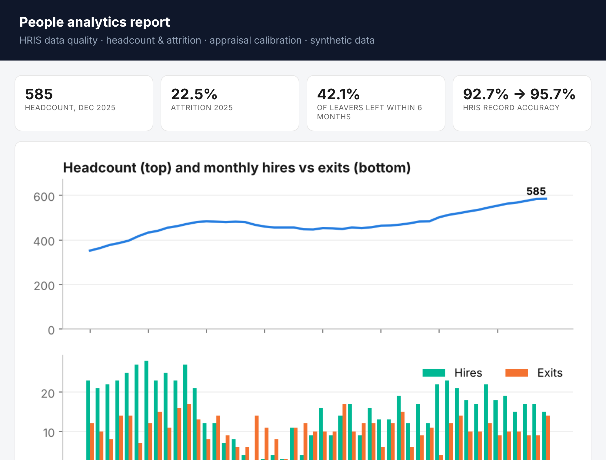
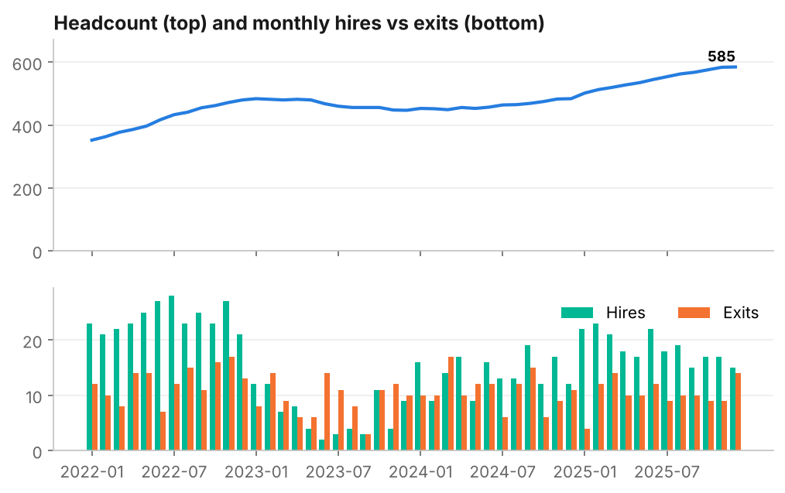
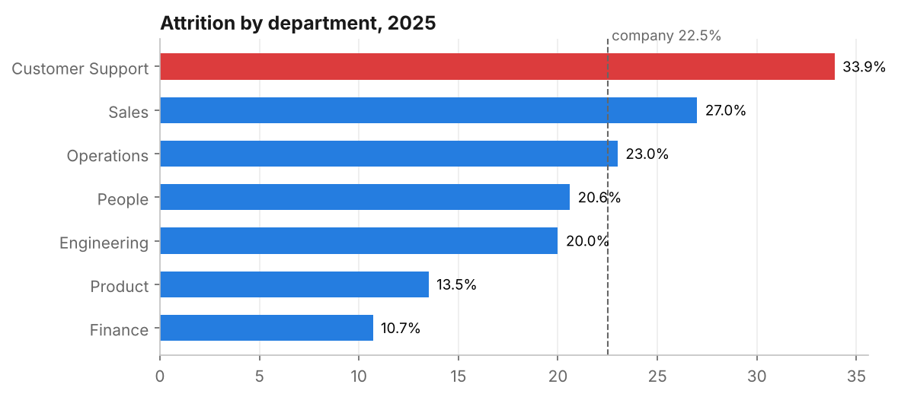
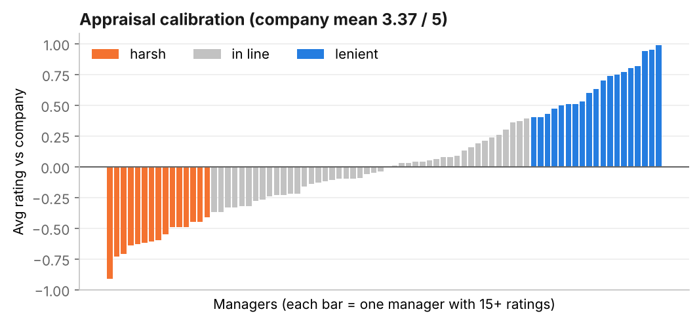

# HR People Analytics

[](https://github.com/mprantikk/hr-people-analytics/actions/workflows/ci.yml)


People analytics for a fast-growing tech company: **clean the HRIS first, then answer the questions leadership actually asks.** How many people are we losing, where, how early, and are our managers rating fairly?

It is based on the kind of work I did in HR analytics and automation at an e-commerce and fintech company: fixing HRIS data so reports could be trusted, analysing attrition, and running performance appraisals. All data here is synthetic.



## 1. HRIS data quality

HRIS exports are messy: the same department typed six ways, three date formats, people marked Active months after they left, double-entered records, managers who no longer exist. `people/quality.py` measures two things separately:

| | Before | After |
|---|---:|---:|
| **Accuracy** (record is right: no duplicates, status matches exit date, valid grade, manager exists, valid email) | 92.7% | 95.7% |
| **Consistency** (standard department names, ISO dates, tidy text) | 5.6% | 100% |

Safe fixes are automatic (deduplication, department mapping, date standardisation, status derived from exit date). Problems that need a person, such as a missing grade or a manager ID that doesn't exist, are **flagged for HR ops instead of guessed**.

## 2. Headcount and attrition



| | 2022 | 2023 | 2024 | 2025 |
|---|---:|---:|---:|---:|
| Annual attrition | 35.5% | 24.0% | 28.1% | 22.5% |

- **42% of leavers go within 6 months of joining.** Onboarding and probation are the biggest lever.
- **Customer Support (33.9%) and Sales (27.0%)** run well above the company rate in 2025.
- Top exit reasons: better offer (28%), career growth (25%), workload (16%).



## 3. Appraisal calibration



Each bar is one manager's average rating compared with the company average. Managers more than half a standard deviation below are flagged *harsh*, above *lenient*.

**Teams under harsh raters lost people at 32.4% a year, against 23.7% under in-line raters.** Calibration sessions are a retention tool, not just a fairness one.

## Run it

```bash
git clone https://github.com/mprantikk/hr-people-analytics.git
cd hr-people-analytics
pip install -r requirements.txt
python -m people.generate     # synthetic HRIS extract + appraisal history (seeded)
python -m people.report       # cleaning, metrics, charts, reports/people_report.html
pytest -v
```

## How it works

```
data/hris_extract_raw.csv ─► quality.issues() ─► quality.clean() ─► metrics ─► charts + HTML report + summary.json
data/appraisals.csv ───────────────────────────────────────────────┘
```

| Module | What it does |
|---|---|
| `people/generate.py` | Seeded synthetic workforce: hiring waves, a 2023 hiring freeze, attrition driven by tenure, performance and manager style |
| `people/quality.py` | 10 data-quality rules, accuracy and consistency scores, safe automatic fixes |
| `people/metrics.py` | Monthly headcount, hires, exits, attrition (by year and department), early attrition, exit reasons, manager calibration, attrition by manager style |
| `people/report.py` | Charts and a self-contained HTML report |

Tests check that each data-quality rule fires on its defect, that cleaning never loses an employee, that headcount balances (change = hires − exits every month), and that metrics stay in sane ranges. CI also regenerates the data to prove it is reproducible and uploads the HTML report.

Built by [Masud Parvej](https://mprantikk.github.io/).
